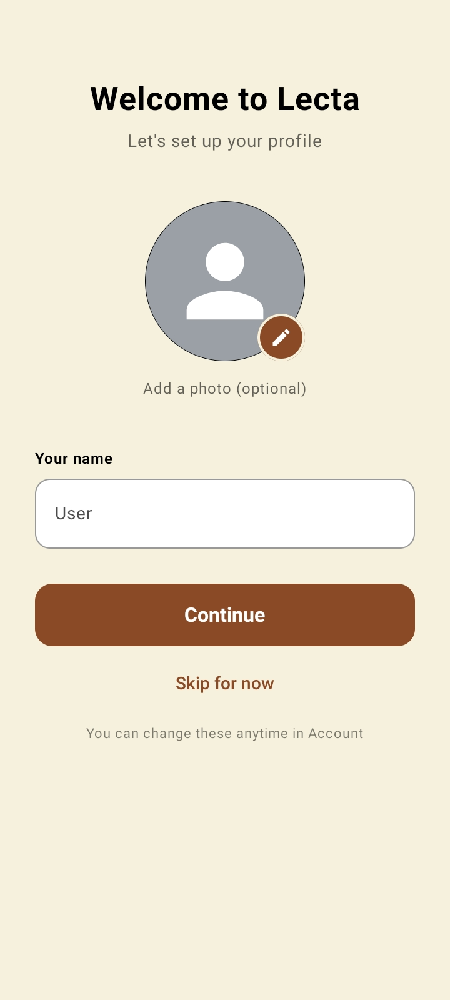
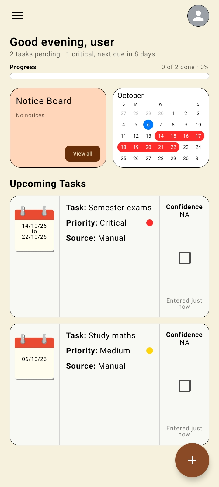
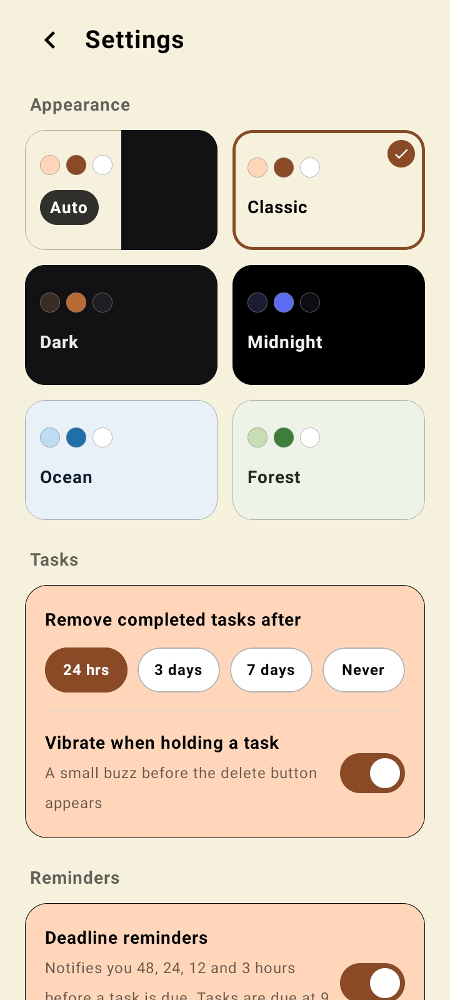

# Lecta

> **College notice → AI reads it → you know exactly what to do.**


Lecta is an Android app that turns college notices into clear, trackable tasks. Upload a PDF notice and Lecta finds what you need to do and by when, and puts everything else on a notice board.

**[Download the latest APK](https://github.com/Tany0625/Lecta/releases/latest)**

---

## The problem

College notices are long, scattered across WhatsApp groups and PDFs, and easy to miss. Important deadlines hide between holiday announcements and room changes.

## What Lecta does

1. You upload a notice as a PDF.
2. The Lecta backend reads the text and an AI model works out what it says.
3. Things you must **do** become tasks with a date (or date range), a priority and a confidence score.
4. Things you only need to **know** (a cancelled lecture, a room change) go to the Notice Board as one-line summaries.
5. You track tasks on a dashboard and calendar and get reminders before deadlines.

One notice can produce several tasks and notices. Duplicates are skipped if you upload the same notice twice.

---

## Screenshots

| First login | Home screen | Theme |
|:---:|:---:|:---:|
|  |  |  |

---

## Features

- AI task extraction from PDF notices
- Priority levels: **Critical**, **High**, **Medium**, **Low**. Exams are always Critical.
- Confidence score (0-100%) showing how sure the AI is that nothing was guessed
- Notice Board for information-only items
- Home dashboard with upcoming tasks and a calendar showing task dates by priority
- Manual task entry
- Task completion and reminders
- Light and dark themes, onboarding, profile, settings and help screens
- All your tasks and notices are stored on your device

---

## Install

1. Open the [latest release](https://github.com/Tany0625/Lecta/releases/latest) on your Android phone and download the `.apk` file.
2. Open the file. Android will ask you to allow installing apps from this source. Allow it for your browser or file manager.
3. Google Play Protect may show a warning because the app is not from the Play Store. Choose **More details → Install anyway**.

Requires Android 8.0 (API 26) or newer.

---

## Architecture

```text
Lecta (Android, Kotlin + Jetpack Compose)
        │  HTTPS, PDF upload
        ▼
Lecta Backend (FastAPI)  ──►  PDF text extraction (pypdf)
        │
        ▼
AI model (Groq)
        │
        ▼
Validation and cleanup (dates checked against the notice, fixed priority rules)
        │
        ▼
JSON  ──►  tasks and notices in the app
```

The backend lives in a separate repository: **[Tany0625/lecta-backend](https://github.com/Tany0625/lecta-backend)**.

The AI's answer is never trusted blindly. The backend checks every date against the notice text, applies fixed priority rules, limits task name length, and lowers the confidence score when something looks guessed.

---

## Tech stack

**Android**
- Kotlin, Jetpack Compose, Material 3
- Local storage with SharedPreferences
- Plain `HttpURLConnection` for networking, no extra libraries

**Backend**
- Python, FastAPI, Uvicorn
- `pypdf` for text extraction
- Groq-hosted language model
- Hosted on Render

---

## Limitations (v1.0)

- **PDF only.** Scanned PDFs and photos are not supported yet because they have no readable text.
- **Slow first upload.** The backend runs on a free server that sleeps when idle. The first upload after a quiet period can take up to a minute.
- **Upload limit.** Each user can send a limited number of notices per hour.
- **Undated tasks.** If a notice gives no exact date, the task is shown with today's date and a lower confidence score.
- **Always double-check.** The AI can make mistakes. Confirm important deadlines with the original notice.

## Privacy

When you upload a notice, its text is sent to the Lecta backend and to an AI service (Groq) to be read. The backend does not store uploaded files or notice text. Do not upload anything private. Your tasks, notices and profile stay on your device.

---

## Project structure

```text
app/src/main/java/com/tany/lecta/
├── AppRoot.kt, MainActivity.kt        app entry and navigation
├── HomeScreen.kt, TaskBox.kt          dashboard and task cards
├── NoticeBoard.kt, CalendarBox.kt     notice board and calendar
├── Dialogs.kt, AddMenu.kt             add task, AI upload dialog
├── NoticeApi.kt                       backend communication
├── Models.kt, Storage.kt              data models and local storage
├── Reminders.kt                       deadline reminders
├── Settings*.kt, Account*.kt, Help*.kt, About*.kt
└── ui/theme/                          colours, typography, themes
```

---

## Build from source

**Requirements:** Android Studio, Android SDK, and a device or emulator.

```bash
git clone https://github.com/Tany0625/Lecta.git
```

1. Open the `Lecta` folder in Android Studio and let Gradle sync.
2. Open `NoticeApi.kt` and set `BASE_URL` to your own backend (see the [backend repo](https://github.com/Tany0625/lecta-backend) for setup).
3. Run the app.

## Security

- This repository contains no AI provider keys, signing keystores or `.env` files. AI keys live only on the backend server.
- Release APKs are signed with a private key that is not part of this repository.

---

## Author

Created by [Tany0625](https://github.com/Tany0625). {Team innovation vultures}
