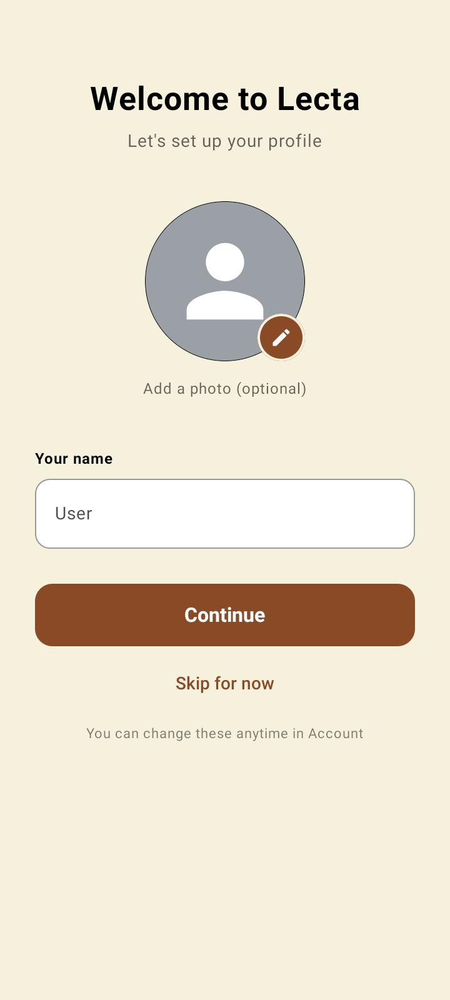
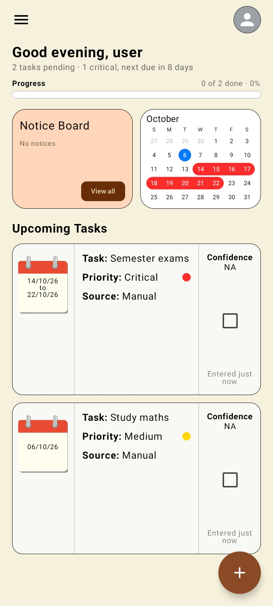
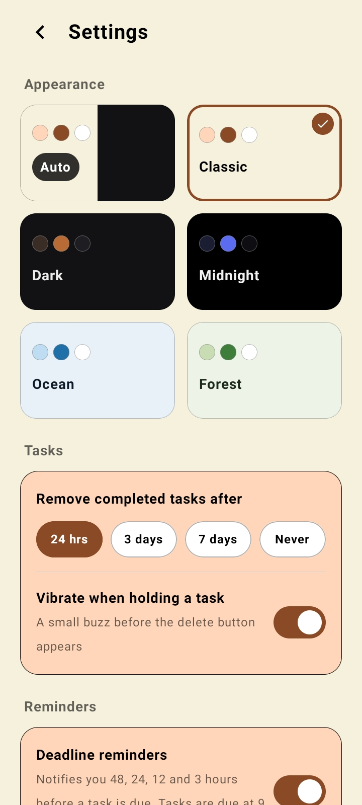

# Lecta

> **College notice → AI understands it → Student knows exactly what to do.**


Lecta is an Android app that helps college students turn official notices into clear, trackable tasks. This repository currently contains the **completed Android UI**. The backend and AI processing are **in active development** for the **MLH Hacktoberfest** hackathon.


---

## Overview

### The problem

College students receive notices containing important information, deadlines, instructions, and events. These notices are often hard to understand and easy to forget.

### The solution

Lecta is designed so that a student can provide a notice, have it understood by AI, and receive a structured result: what the notice is about, what they need to do, and by when. If the notice contains an actionable task, the student can add it to their task list and track it through its deadline.

---

## Current status

| Area | Status |
|---|---|
| Android UI (Kotlin + Jetpack Compose) | ✅ Implemented |
| Backend (FastAPI + Pydantic) | 🛠 In active development |
| PDF text extraction | 🛠 Planned / In progress |
| AI Integration (Google Gemma 4) | 🛠 In active development |
| Android ↔ backend communication | 🛠 Planned |

> **This repository represents the completed frontend/UI stage of Lecta.** The backend logic—using **Google's Gemma 4** via an OpenAI-compatible interface—is being developed as the main project submission for MLH Hacktoberfest.

---

## Features (currently implemented)

The current Android project includes the following UI:

- Lecta branding, splash screen and onboarding
- Home / dashboard
- Notice Board
- Calendar that visually represents task dates and priority
- Upcoming Tasks and task cards
- Task completion
- Priority levels: **Critical**, **High**, **Medium**, **Low**
- Task dates / deadlines and task confidence information
- Add-task UI
- Reminders-related UI
- Profile / menu, Account, Settings, Help, and About screens
- Theme management
- Local storage-related code

The UI is designed primarily for **Android phones**.

---

## Screenshots

| First login | Home screen | Theme |
|:---:|:---:|:---:|
|  |  |  |

---

## How Lecta will work

1. The student provides a college notice.
2. Lecta backend extracts the text.
3. **Google Gemma 4** processes and understands the notice.
4. Important information is structured into JSON using Pydantic schemas.
5. The student receives a clear, structured task on the app.
6. The student tracks the task and its deadline on their dashboard/calendar.

### Planned inputs

The immediate backend milestone is **PDF notices**. Screenshots/images and pasted notice text are possible future inputs.

---

## Architecture

```text
Android App
      │
      │ HTTPS
      ▼
Lecta Backend (FastAPI)
      │
      ▼
Gemma 4 Client
      │
      ▼
Google Gemma 4 AI Model (via Ollama / Cloud)
      │
      ▼
Structured JSON (Pydantic Schema)
      │
      ▼
Android App
      │
      ▼
LectaTask
```

---

## Technology stack

**Android (Frontend)**
- Kotlin
- Jetpack Compose
- Material 3
- Android Studio, Gradle, Android SDK

**Backend (In Development)**
- Python 3.12+
- FastAPI & Uvicorn
- PDF text extraction (`PyPDF2` / `pdfplumber`)
- **Google Gemma 4** (running locally via Ollama during development, deployable to cloud)
- Pydantic (data validation and structured JSON output)

---

## Project structure

```text
app/
├── src/
│   ├── main/
│   │   ├── java/com/tany/lecta/
│   │   │   ├── AboutScreen.kt
│   │   │   ├── AccountScreen.kt
│   │   │   ├── AddMenu.kt
│   │   │   ├── AppInfo.kt
│   │   │   ├── AppRoot.kt
│   │   │   ├── CalendarBox.kt
│   │   │   ├── Dialogs.kt
│   │   │   ├── Greeting.kt
│   │   │   ├── HeaderAndMenu.kt
│   │   │   ├── HelpScreen.kt
│   │   │   ├── HomeScreen.kt
│   │   │   ├── MainActivity.kt
│   │   │   ├── Models.kt
│   │   │   ├── NoticeBoard.kt
│   │   │   ├── OnboardingScreen.kt
│   │   │   ├── PageComponents.kt
│   │   │   ├── Reminders.kt
│   │   │   ├── Settings.kt
│   │   │   ├── SettingsScreen.kt
│   │   │   ├── SplashScreen.kt
│   │   │   ├── Storage.kt
│   │   │   ├── TaskBox.kt
│   │   │   ├── TaskList.kt
│   │   │   ├── ThemeManager.kt
│   │   │   └── ui/theme/
│   │   │       ├── Color.kt
│   │   │       ├── Theme.kt
│   │   │       └── Type.kt
│   │   └── res/
│   └── ...
├── build.gradle.kts
└── ...
```

The app is structured cleanly into modular Jetpack Compose screens, reusable UI components, local storage models, and theme management.

---

## Task model

The task model includes concepts such as ID, title, source, priority, start date, end date, confidence, extracted information, and completion state. Priority is one of `Critical`, `High`, `Medium`, or `Low`.

---

## Backend & Gemma 4 Integration

> **Status: In Active Development.**

The backend pipeline performs the following steps:

1. Receives a PDF notice uploaded from the Android app.
2. Extracts raw text content from the PDF.
3. Sends the extracted text to **Google Gemma 4** with deterministic system prompts (`temperature=0.2`).
4. Forces the model output into validated Pydantic JSON schemas.
5. Returns structured task objects to the Android app.

```text
PDF Notice
    ↓
Lecta Backend
    ↓
Text Extraction
    ↓
Google Gemma 4 AI
    ↓
Structured JSON Task
    ↓
Android App UI
```

### Response format

Structured JSON output schema returned by the Gemma 4 pipeline:

```json
{
  "summary": "Semester 1 pre-medical examination",
  "action": "Attend the pre-medical examination",
  "deadline": "2026-10-07",
  "audience": "Semester 1 medical students",
  "priority": "Critical",
  "type": "Action",
  "confidence": 93
}
```

---

## Hackathon Context

Lecta is competing in **MLH Hacktoberfest** with a target track focused on **Best Use of Google Gemma 4**. 
- **Frontend MVP:** Completed Jetpack Compose Android app.
- **Hackathon Scope:** Building, testing, and integrating the complete FastAPI backend powered by **Google Gemma 4**.

---

## Security and API keys

- This repository contains no API keys, secrets, keystores, or `.env` files.
- `local.properties`, build outputs, virtual environments (`venv/`), and `.env` configuration files are excluded through `.gitignore`.
- When deployed, environment configurations and API endpoints are injected via server environment variables.

---

## Running the project

### Android App
**Requirements:** Android Studio, Android SDK, and an Android emulator or physical device.

```bash
git clone git@github.com:Tany0625/Lecta.git
cd Lecta
```

1. Open Android Studio and choose **Open**, then select the `Lecta` folder.
2. Wait for Gradle sync to complete.
3. Run the app on an emulator or connected device.

---

## Author

Created by [Tany0625](https://github.com/Tany0625). {Team innovation vultures}
